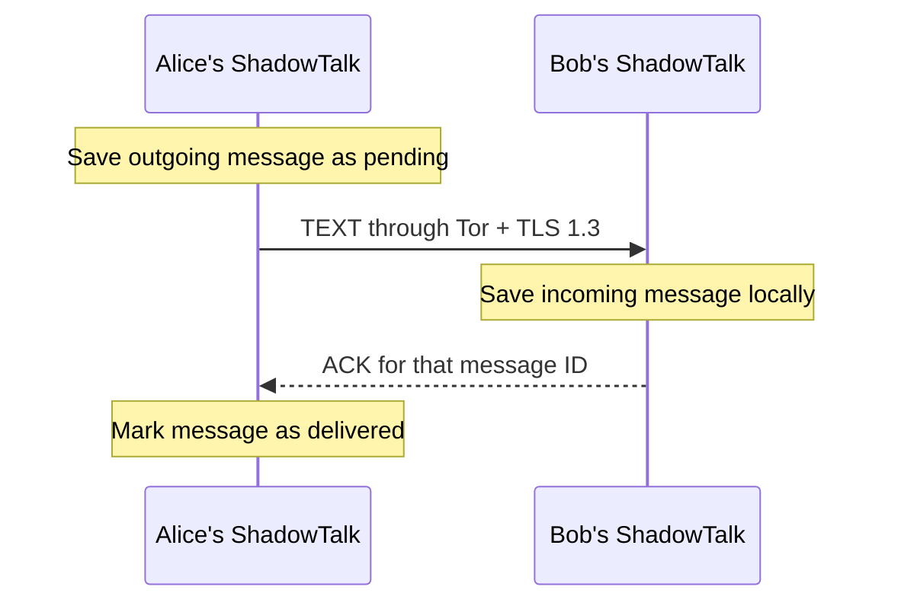

<div align="center">

  

  <h1>ShadowTalk</h1>

  <p>
    <b>A peer-to-peer messenger for your terminal.</b><br>
    Built in Go. Connects through Tor. Identity through cryptographic keys.
  </p>

  <p>
    <a href="https://go.dev/dl/"></a>
    <a href="https://github.com/bacrehclb/ShadowTalk/actions/workflows/test.yml?query=branch%3Amain"></a>
    <a href="LICENSE"></a>
    <br>
    
    
  </p>

  <p><b>English</b> · <a href="README.ru.md">Русский</a></p>
  <p><b><a href="https://github.com/bacrehclb/ShadowTalk/releases/tag/v0.1.0-alpha.1">Download v0.1.0-alpha.1</a></b> — macOS · Windows · Linux</p>
  <p>
    <a href="#how-it-works">How it works</a> ·
    <a href="#quick-start">Quick start</a> ·
    <a href="#usage">Usage</a> ·
    <a href="#troubleshooting">Troubleshooting</a><br>
    <a href="#local-data-and-security">Local data</a> ·
    <a href="#project-structure">Code guide</a> ·
    <a href="#current-limits-and-next-checks">Limitations</a> ·
    <a href="#documentation">Documentation</a>
  </p>

</div>

---

## Overview

ShadowTalk is an open-source terminal messenger written in Go. Create a local identity, exchange invitations with someone you trust, and communicate through Tor onion services without a shared ShadowTalk server. A nickname is a display name; your cryptographic key is your identity.

> **Experimental alpha:** one-to-one terminal chat, encrypted message history and delivery retries are implemented. Commands and storage formats may change between alpha versions. There has been no independent security audit.
>
> Current development is on **[main](https://github.com/bacrehclb/ShadowTalk/tree/main)**. For a released version, use its tag, release notes and bundled documentation.

## What works today

| Feature | Available behavior |
| --- | --- |
| Local identity | Ed25519 keys, a full SHA-256 fingerprint and a persistent profile |
| Key storage | AES-256-GCM encrypted seed; encryption key stored in the OS credential store |
| Terminal UI | Profile management, contact selection, message editor, paginated history and delivery status |
| Invitations | Signed tokens with an onion address, public key and expiration time |
| Contacts | Local aliases, explicit fingerprint confirmation and persistent storage |
| Secure channel | TLS 1.3 with mutual verification of confirmed identity keys |
| Tor transport | Managed Tor process and stable v3 onion address |
| History | Encrypted message text, duplicate detection and paginated history |
| Delivery | Persistent outgoing queue, acknowledgement after saving, retries after restart and pending/delivered states |
| Distribution | macOS DMG, Windows setup EXE and Linux DEB/RPM installers |

Live delivery and restart recovery were verified through the public Tor network using obfs4 with two nodes on one macOS arm64 computer. Separate-device exchange and live Windows/Linux networking remain unverified. See the [live test report](docs/testing/tor-live-exchange.md) for the exact scope.

## How it works

### Identity and finding a contact

There is no ShadowTalk account server or global nickname directory. Creating a
profile generates a random **seed** — the secret from which your identity keys
can be restored. ShadowTalk uses Ed25519 for the identity and derives separate
keys for its onion service and local message history. Reopening the same profile
keeps the same identity and onion address; creating another profile with the same
nickname does not restore the old one.

To find each other, you exchange **signed invitation tokens** outside ShadowTalk.
A token carries a public identity key, an onion address and an expiry time.
After comparing the full key fingerprint with the other person, each participant
saves the other as a contact. The local alias is just a convenient label; trust
and conversations are tied to the public key.

### Connection and message delivery

`shadowtalk chat` loads the profile and confirmed contacts, opens local history,
starts its own Tor process and publishes the profile's onion service. In obfs4
mode it also starts Lyrebird. The chat screen becomes usable after network startup.
Each peer connection then uses **TLS 1.3 with mutual identity verification**:
both sides must prove possession of a key already saved by the other participant.
The invitation establishes which key to trust; TLS checks that key on connection.



Saving comes before sending. If the peer is unavailable or the acknowledgement
is lost, the outgoing message remains in the local queue. ShadowTalk retries with
the same message ID, including after a restart; the receiver recognizes duplicates
instead of adding another copy to history.

**Delivered** means the peer acknowledged saving the message. It is not a read
receipt or independent proof of what a modified peer did. **Pending** means that
acknowledgement has not arrived. Both participants need overlapping time with
`chat` running and Tor ready: there is no shared message server or offline mailbox.
Closing chat stops its network processes; it does not erase saved history or the
outgoing queue.

## Quick start

Both participants install ShadowTalk, create their own profile and configure Tor.
Then exchange invitations **in both directions** and open the chat. The walkthrough
below uses Alice and Bob; run only the commands for your side on your own computer.

### 1. Install ShadowTalk

Download **[ShadowTalk v0.1.0-alpha.1](https://github.com/bacrehclb/ShadowTalk/releases/tag/v0.1.0-alpha.1)**.
Open **Assets** on that page and choose the installer below. This is a published
prerelease; read its release notes before installing. Other versions are listed
in [GitHub Releases](https://github.com/bacrehclb/ShadowTalk/releases).

| Platform | Architectures | Downloads |
| --- | --- | --- |
| macOS 12+ | Apple Silicon and Intel, in one app | `_darwin_universal.dmg` (contains `ShadowTalk.app`) |
| Windows | x64 (`amd64`) | `_setup.exe` |
| Linux | `arm64`, `amd64` | `.deb`, `.rpm` |

Download one installer for your OS and processor. Portable archives, standalone
PKGs and maintainer files remain in the `shadowtalk-packages` CI artifact from
[Packages](https://github.com/bacrehclb/ShadowTalk/actions/workflows/packages.yml?query=branch%3Amain).
GitHub's **Source code** archives contain source, not a ready-to-run application.

Packages include a dependency notice file and are distributed with SHA-256
checksums. Builds have no verified publisher signature; the macOS app has an
ad-hoc signature and is not notarized.
Go is only needed to [build from source](#development).

**macOS:** open the universal DMG, drag **ShadowTalk.app → Applications**, then
open the copied app. Terminal opens with a menu: **1 — Профиль** (profile),
**2 — Чат** (chat), **3 — Команды** (commands), **0 — Выход** (exit).
Use **3** for the `shadowtalk ...` commands below; this command is available in
the app's prompt without changing your system PATH. The app opens a terminal
interface. Build instructions are in the [macOS app guide](docs/macos-app.md).
The CI artifact still contains the alternative PKG installer and portable archives.

**Windows:** run the setup EXE, keep the PATH option enabled, then open a **new**
PowerShell or Windows Terminal window after installation.

**Linux:** open a terminal in the download directory and run the command for your
distribution. Replace `VERSION` and `ARCH` with the exact downloaded filename:

```sh
# Debian / Ubuntu
sudo apt install ./shadowtalk_VERSION_linux_ARCH.deb

# Fedora / distributions using DNF
sudo dnf install ./shadowtalk_VERSION_linux_ARCH.rpm
```

Run `shadowtalk --version` to check the installation. See the
[installation guide](docs/install.md) for checksum verification and removal.

### Requirements

- **Tor and Lyrebird** are included in builds for the upcoming alpha.2. The published alpha.1 still needs a separate installation. See [bundled Tor](docs/bundled-tor.md) and the [connection guide](docs/tor.md).
- **An accessible OS credential store:** Keychain on macOS, Credential Manager on Windows, or Secret Service over a user D-Bus session on Linux. Linux needs a running secret service with an available login/default collection; D-Bus alone is not enough.
- **An interactive terminal:** at least 40 × 20 for the profile UI and 60 × 20 for chat.

### 2. Create your profile

On macOS, open ShadowTalk.app and choose **3 — Команды**. On Windows/Linux,
open a terminal after installation. Then run:

```sh
shadowtalk --version
shadowtalk ui
```

The examples below use `shadowtalk` in the app's command prompt or on PATH.
You can also choose **1 — Профиль** in the app menu to open the profile TUI directly.
For a portable archive, use
`./shadowtalk` on macOS/Linux or `.\shadowtalk.exe` in PowerShell from the
extracted directory. For a source build, use the binary path shown under
[Development](#development). Profile and contact commands work without Tor.

Enter a nickname and press **Enter** to create your profile. On subsequent launches, ShadowTalk loads the same identity. Your OS may ask you to unlock or allow access to its credential store.

For this walkthrough, Alice can use `alice_01` and Bob `bob_01`. Once the profile
is shown, press **Esc** to return to the terminal. `ui` manages your profile;
the conversation opens later with `chat`.

Nicknames contain **3–24 characters**: Latin letters, digits, `_` and `-`, with a letter or digit at each end. They are case-sensitive and do not need to be globally unique.

| Key | Action |
| --- | --- |
| Enter | Confirm the action shown on screen |
| `r` | Reload the profile; while entering a nickname, type the letter normally |
| Esc / Ctrl+C | Exit after any active key operation finishes |

The interface and command output are currently in Russian. The TUI requires terminal stdin and stdout; use the regular commands below in scripts. A nonempty `NO_COLOR` disables colors.

## Usage

### Manage your profile

If you have not created a profile through the TUI:

```sh
shadowtalk profile create --nick alice_01
```

View your profile and public-key fingerprint:

```sh
shadowtalk profile show
```

Creating a profile does not overwrite an existing one. `profile upgrade` adds keys to an older profile that only contains metadata. `profile recover` handles interrupted creation; it cannot restore a lost OS encryption key.

<a id="tor-setup"></a>

### 3. Configure Tor on each computer

Builds for **alpha.2** include Tor and Lyrebird and find them automatically.
For direct Tor, no configuration file is required. ShadowTalk starts and stops
its own process; opening Tor Browser does not configure ShadowTalk.

For the published **alpha.1** or a source build without bundled runtimes, download
the stable [Tor Expert Bundle](https://download.torproject.org/tor/) for your OS/CPU
and keep its libraries alongside the binaries. Set `tor_binary` to your `tor`
executable; for obfs4 also set `lyrebird_binary` to `lyrebird` (both end in `.exe`
on Windows). These optional paths override bundled executables in alpha.2.

Choose **direct Tor** if your network allows it, or **obfs4** if you need bridges.
Alice and Bob may use different connection modes and different bridges.

For bridges or custom settings, create a plain-text **UTF-8 file without a BOM**,
named `tor.json`, in your [profile directory](#local-data-and-security).
The examples use automatic executable discovery in alpha.2. For alpha.1, add
the executable paths described above.

**Direct connection:**

```json
{
  "version": 1,
  "mode": "direct",
  "startup_timeout": "5m"
}
```

Without `tor_binary`, ShadowTalk uses its bundled Tor, or PATH when no bundle
is installed. With no default `tor.json`, it uses direct Tor with a 3-minute
startup timeout. Existing explicit paths remain active after an upgrade.

**Connection through obfs4 bridges:** get fresh **obfs4** bridge lines from
[Tor Project's bridge service](https://bridges.torproject.org/) or the alternatives
in its [bridge guide](https://support.torproject.org/little-t-tor/circumvention/using-bridges/).
Replace the entire example bridge line below with a real one:

```json
{
  "version": 1,
  "mode": "obfs4",
  "startup_timeout": "5m",
  "bridges": [
    "obfs4 IP:PORT FINGERPRINT cert=CERTIFICATE iat-mode=0"
  ]
}
```

Each bridge is one complete quoted string in the array, with commas **between**
strings. Keep its fingerprint, `cert` and `iat-mode` exactly as supplied. The
example is a placeholder, not a working bridge. ShadowTalk supports 1–16 obfs4
lines; Snowflake and WebTunnel are not supported by this version.

For custom executables on **Windows**, use paths such as `C:/Tools/Tor/tor/tor.exe` and the actual path
to `lyrebird.exe`. Forward slashes work in JSON; backslashes must be doubled.
Make sure your editor saved `tor.json`, not `tor.json.txt`.

On **macOS/Linux**, restrict access after saving. Run only the command for your OS:

```sh
# macOS
chmod 600 "$HOME/Library/Application Support/shadowtalk/tor.json"

# Linux
chmod 600 "${XDG_CONFIG_HOME:-$HOME/.config}/shadowtalk/tor.json"
```

For a custom profile directory, use that directory instead. Keep bridge files
private. JSON does not allow comments or trailing commas; unknown fields are
rejected. Relative executable paths in JSON are resolved from the JSON file's
directory. See [Tor configuration](docs/tor.md#конфигурация-подключения) for details.

### 4. Exchange and confirm invitations

An invitation contains your public key, onion address and expiry time. It lets
the other person add you as a contact. **Both participants must add each other.**
Creating and inspecting invitations works without a running Tor connection.

**Alice creates her invitation** and displays her own fingerprint:

```sh
shadowtalk profile show
shadowtalk invite create --ttl 24h > alice.invite
```

**Bob creates his invitation** on his computer:

```sh
shadowtalk profile show
shadowtalk invite create --ttl 24h > bob.invite
```

In **Windows PowerShell**, use the matching command below instead of `>` so
the file is saved without an encoding marker. Run only your own line:

```powershell
# Alice
shadowtalk invite create --ttl 24h | Set-Content -Encoding ascii alice.invite
# Bob
shadowtalk invite create --ttl 24h | Set-Content -Encoding ascii bob.invite
```

Send `alice.invite` to Bob and `bob.invite` to Alice through a channel you already
use. The files are created in your terminal's current directory. Save the received
file there too, or pass its full path to `--file`. A token sent as text must remain
one intact line, without quotes, formatting or extra spaces.

**Alice inspects Bob's file:**

```sh
shadowtalk invite inspect --file bob.invite
```

Compare the **full fingerprint** with the one Bob sees in `shadowtalk profile show`,
using a trusted channel, for example in person or on a known voice call. A valid
signature confirms the key, not the person's identity. If they match, Alice adds
Bob; replace `SHA256:...` with Bob's complete confirmed fingerprint:

```sh
shadowtalk contacts add --alias bob --fingerprint "SHA256:..." --file bob.invite
shadowtalk contacts show --alias bob
```

**Bob does the same for Alice:** inspect her invitation, independently compare
the fingerprint with Alice, then use **Alice's** full fingerprint in the add command:

```sh
shadowtalk invite inspect --file alice.invite
shadowtalk contacts add --alias alice --fingerprint "SHA256:..." --file alice.invite
shadowtalk contacts show --alias alice
```

`--alias` is your local name for the contact: Alice uses `bob`, Bob uses `alice`.
It follows the nickname rules and need not match the other person's profile nick.
These commands save local contacts; the network starts when you run `chat`.

- Invitations expire after **24 hours** by default; `--ttl` accepts whole seconds from `1s` to `168h`.
- Tokens contain public identity data, including the onion address, but no private keys. Share them deliberately.
- Tokens can be reused until they expire. Single-use acceptance and revocation are not implemented. Saved contacts remain after token expiry.
- `--file -` reads one token from stdin until EOF. Results go to stdout, errors to stderr; failures return exit code `1`.

Remove a local contact by confirming its stored fingerprint:

```sh
shadowtalk contacts remove --alias alice --fingerprint SHA256:...
```

This removes the local entry; it does not revoke invitations. For command details, use `--help`, `invite --help` or `contacts --help`.

### 5. Send your first message

With the confirmed contacts saved and `tor.json` configured, **Alice runs**:

```sh
shadowtalk chat --contact bob
```

**Bob runs** on his computer:

```sh
shadowtalk chat --contact alice
```

Keep both chat windows open. Wait for each to finish connecting to Tor and
publishing its onion service; 100% bootstrap alone is not the end of startup.
Once the conversation appears, press **Tab** if needed to focus the message
editor, type a short message and press **Enter**. Ask the other person to reply.

The outgoing status changes from `ожидает доставки` (pending) to `доставлено`
(delivered) after the other device confirms saving it. `Tor готов` means your
own Tor node is ready; it does not prove that the other person is online.

For a configuration file outside the default profile directory:

```sh
shadowtalk chat --contact bob --tor-config "/absolute/path/to/tor.json"
```

To override the bundled Tor, specify your executable (including `tor.exe` on Windows):

```sh
shadowtalk chat --tor-binary "/path/to/tor" --startup-timeout 5m
```

The screen shows Tor's bootstrap percentage and stage, then contacts, history and the message editor. The default Tor startup timeout is 3 minutes; `--startup-timeout` accepts 1 second to 15 minutes. History opens after Tor is ready. Omitting `--contact` selects the first saved contact. Contacts and invitations are managed using the commands above; restart chat to apply changes.

Connection settings can be saved in `tor.json` inside the profile directory, or selected with `chat --tor-config "/path/to/tor.json"`. Explicit `--tor-binary` and `--startup-timeout` flags override the file. A missing default file uses direct Tor; an invalid file stops startup. Retrying with Enter / `r` reloads the file.

Bridge mode never silently falls back to direct Tor. If startup fails, correct
the configuration or replace unavailable bridges, then press **Enter** or **r**
on the error screen to retry. Changes during a running chat require a restart.

### 6. Everyday use and keyboard controls

Next time, run `shadowtalk chat --contact bob` (Alice) or
`shadowtalk chat --contact alice` (Bob). You do not need to create another profile
or exchange new invitations for already saved contacts. To choose from all saved
contacts, run `shadowtalk chat`; `shadowtalk contacts list` lists their aliases.

| Key | Chat action |
| --- | --- |
| Tab | Switch between contacts and message input |
| ↑ / ↓ in contacts | Select a conversation |
| Enter | Open the selected conversation or queue the message |
| Alt+Enter / Ctrl+J | Insert a newline |
| PgUp / PgDn | Scroll history; PgUp at the top loads older records |
| Ctrl+L | Return to the latest messages and statuses |
| Ctrl+R after a save error | Retry the same message without changing its ID |
| Esc / Ctrl+C | Stop networking and exit |

A `•` beside a contact marks changes during this session. It is not a read receipt. **Pending** messages stay in the encrypted local queue; **delivered** means the peer acknowledged saving them. Both users must be online for delivery. Saved messages resume automatically on the next `chat` launch; unsaved drafts are kept only in memory. The screen keeps up to 200 history records at a time; the database retains older records.

Message text is limited to 16384 UTF-8 bytes. Oversized pastes are rejected, and terminal control sequences are displayed safely. `chat` requires terminal input and output; it does not accept piped messages. Details: `chat --help`.

Exit with **Esc** or **Ctrl+C** and let ShadowTalk finish stopping Tor. Delivery
runs while `chat` is open; there is no background mailbox server. After a restart,
saved history and queued messages use the same profile. Times in chat are UTC.

## Troubleshooting

| Symptom | What to check |
| --- | --- |
| `shadowtalk` is not found | For the macOS app, use **3 — Команды** in its menu. On Windows, enable the installer's PATH option and open a new terminal; for a portable build, use the executable's full path. |
| `ui` shows a profile but no conversation | Exit with Esc and run `shadowtalk chat`; invitations and contacts are managed with the commands in step 4. |
| Tor or Lyrebird is not found | Point `tor_binary` / `lyrebird_binary` to the executable, not its folder. On Windows include `.exe`; keep Expert Bundle libraries in place. |
| Tor startup times out | Check connectivity, update obfs4 bridges if needed, and retry. You can use `--startup-timeout 10m`; the allowed maximum is `15m`. |
| `Небезопасный tor.json` / invalid configuration | Use a regular UTF-8 file without a BOM, valid JSON and real paths/bridge lines. On macOS/Linux run `chmod 600` on that file. |
| Invitation is expired or damaged | Ask the sender to create a new token. Preserve the entire line; use the ASCII command above in PowerShell. Check the system date/time on both devices. |
| Fingerprints do not match | Stop the import and verify the full value with the contact. Do not substitute an unverified fingerprint just to make the command pass. |
| Contact is missing or the alias is rejected | Run `shadowtalk contacts list`, check which profile directory you are using, and restart chat after importing a contact. |
| Messages remain pending | Both users must have `chat` running and Tor ready, and both must have imported each other's current identity. Keep the windows open for automatic retries. |
| Credential store is unavailable | Unlock/allow access to the OS key store. On Linux, use a user session with a running Secret Service and an unlocked login/default collection; do not run chat with `sudo`. |
| Window is too small | Enlarge it to at least 60 columns × 20 rows. Run in an interactive terminal with stdin/stdout attached. |

For a bug report, include your OS, `shadowtalk --version`, the command used and
the error text. Remove invitation tokens, bridge lines and personal paths before
sharing logs. Keep private keys, profile files and message history out of issues.

## Local data and security

### Where the profile lives

ShadowTalk stores data for the current OS user, separately from the installed
executable. The macOS app and the standalone CLI use the same default location:

| OS | Default profile directory |
| --- | --- |
| macOS | `~/Library/Application Support/shadowtalk` |
| Linux | `$XDG_CONFIG_HOME/shadowtalk` or `~/.config/shadowtalk` |
| Windows | `%AppData%\shadowtalk` |

To use a different directory, put `--profile-dir` **before** the command:

```sh
shadowtalk --profile-dir ./data/demo ui
```

Relative paths start at the terminal's working directory. Use the same
`--profile-dir` for subsequent `profile`, `invite create`, `contacts` and `chat`
commands to work with that identity. For example:

```sh
shadowtalk --profile-dir ./data/demo profile show
shadowtalk --profile-dir ./data/demo chat
```

### What is stored

These files appear as you create a profile, add contacts and open chat; not all
exist immediately after installation.

| Location | Contents and purpose |
| --- | --- |
| `profile.json` | Nickname, creation time and public identity key. Unencrypted metadata; no private key. |
| `identity-seed.json` | The private seed encrypted with AES-256-GCM, plus the ID of its key in the OS credential store. |
| `contacts.json` | Local aliases, confirmed public keys, onion addresses and contact dates. Unencrypted; reveals contact relationships. |
| `messages.db` | SQLite history and outgoing delivery queue. Message text is encrypted with XChaCha20-Poly1305 using a key derived from the profile seed. |
| `messages.db-wal`, `messages.db-shm` | SQLite companion files that may exist while history is open. They are part of the database's operation. |
| `tor.json` | Optional connection settings: mode, executable paths, timeout and bridge lines. Plain text; create it as described in [Tor setup](#tor-setup). |
| `tor/` | Tor's working data. Temporary `.shadowtalk-run-*` directories contain per-run control files and, in bridge mode, Lyrebird state; normal shutdown removes those temporary directories. |
| `profile-pending.json` | Recovery journal with profile metadata, encrypted seed and OS key ID for interrupted creation or upgrade. Normally removed when the operation completes. |
| `.profile.lock`, `.contacts.lock`, `.messages.lock`, `tor/.shadowtalk.lock` | Coordinate access to profile files, contacts, history and the Tor directory. Their presence alone does not mean the app is still running; do not delete them to bypass a lock. |
| OS credential store, outside this directory | The random key that decrypts the seed: macOS Keychain, Windows Credential Manager or Linux Secret Service. The service name is `ShadowTalk/seed-encryption/v1`; the entry's account is the `key_id` from `identity-seed.json`. |

Invitation files such as `alice.invite` are created wherever you redirect command
output, not automatically inside the profile directory. They contain public
identity and address data, so share them only with intended contacts.

### What encryption protects

Encryption protects the seed file and **message text**, not the entire profile
directory or SQLite database. Peer keys, message IDs, directions, timestamps,
message lengths and delivery metadata remain visible in history. There is no
separate ShadowTalk password and no plaintext fallback for the OS encryption key.
Access to an unlocked OS account and its credential store can expose the identity
and history; local encryption is not protection against a compromised running OS.

### Backups, upgrades and recovery

Replacing the executable or app does not replace the profile. Keep using the same
directory and OS account. Alpha storage formats may change, so read release notes
before upgrading or downgrading.

**Copying the profile directory alone is not a portable identity backup.** Restoring
the identity requires both the encrypted seed and its matching OS key. History
also needs the original seed to be decrypted. There is currently no supported
portable backup/export command or synchronization between devices. A matching
nickname, public key or invitation cannot recover the secret.

`profile recover` finishes an interrupted local creation or upgrade using its saved
journal and matching OS key. It cannot recreate secrets that are no longer stored.
Close ShadowTalk before making a filesystem copy of the profile, and keep any
SQLite companion files together with the database. Such a copy still does not
include the OS key. Do not delete or hand-edit profile files
to fix a startup error. The [security notes](docs/security.md) describe the formats,
trust model and protection limits in more detail.

<a id="roadmap"></a>

## Current limits and next checks

The first public alpha is **[v0.1.0-alpha.1](https://github.com/bacrehclb/ShadowTalk/releases/tag/v0.1.0-alpha.1)**.
Its scope is one-to-one text chat with local history and delivery retries.

The upcoming **[alpha.2](docs/releases/v0.1.0-alpha.2.md)** bundles Tor and Lyrebird.
Its [packaging checks](https://github.com/bacrehclb/ShadowTalk/actions/runs/45964087325)
passed on Linux, macOS and Windows, including installed runtime execution.
This is preparation for release; the download above still points to alpha.1.
When upgrading, keep your profile and remove `tor_binary` / `lyrebird_binary`
from `tor.json` only if you want to switch from custom paths to the bundled tools.

- Separate-device exchange and live Windows/Linux networking still need validation; successful automated tests do not establish those results.
- Bridges may still be necessary with bundled Tor. The chat screen requires successful Tor startup, including to browse saved history.
- Contacts and invitations are managed by CLI commands; changes to contacts require restarting chat. The interface is currently in Russian.
- Group chats, attachments, read receipts, a desktop GUI and multi-device synchronization are not implemented. The macOS `.app` opens Terminal.
- History has no automatic retention limit; the 200-record UI limit only bounds what is loaded on screen.

Group rooms and a possible GUI are future directions with no committed release
date. The terminal client comes first.

## Project structure

The application is one Go module with its executable entry point in
[`cmd/shadowtalk`](cmd/shadowtalk). The terminal interface, chat rules, network
transport and storage are separate packages. The macOS launcher is a packaging
wrapper around this same executable.

| Module | Responsibility |
| --- | --- |
| [`cmd/shadowtalk`](cmd/shadowtalk) | Parses commands and flags, selects the profile directory, wires concrete services and translates errors for the user. Start reading at [`cli.go`](cmd/shadowtalk/cli.go); chat wiring is in [`chat_cli.go`](cmd/shadowtalk/chat_cli.go). |
| [`internal/app`](internal/app) | Coordinates use cases: profile creation/recovery, contact import and network/history startup. [`StartDelivery`](internal/app/delivery.go) assembles the complete chat service and handles startup cleanup. |
| [`internal/identity`](internal/identity) | Nickname rules, profiles, Ed25519 keys, seed encryption and separate onion/history key derivation. No filesystem or terminal UI. |
| [`internal/contacts`](internal/contacts) | Invitation signing/validation, expiry, fingerprint confirmation and trusted contact rules. Persistence is provided separately. |
| [`internal/tui`](internal/tui) | Bubble Tea profile and chat screens: keyboard input, contact selection, history paging and safe rendering. Calls services instead of issuing SQL or opening sockets. |
| [`internal/delivery`](internal/delivery) | Saves outgoing messages, schedules retries, handles acknowledgements and saves incoming messages before acknowledging them. Owns delivery behavior, not the terminal. |
| [`internal/chat`](internal/chat) | Live dialogs over authenticated sessions: sending/receiving text, acknowledgements and application events. Does not make messages durable by itself. |
| [`internal/peers`](internal/peers) | Connects to confirmed contacts, accepts trusted incoming peers, applies connection limits and manages session lifetimes. |
| [`internal/securechannel`](internal/securechannel) | Wraps an existing connection in TLS 1.3 and verifies pinned identity keys on both sides. Does not discover contacts or start Tor. |
| [`internal/torbundle`](internal/torbundle) | Locates packaged Tor/Lyrebird relative to the application, with explicit paths taking precedence. No downloads or profile changes. |
| [`internal/transport/tor`](internal/transport/tor) | Starts/stops Tor and Lyrebird, tracks bootstrap, publishes the onion service and dials through SOCKS. |
| [`internal/onion`](internal/onion) | Parses and validates v3 onion addresses independently of a running Tor process. |
| [`internal/protocol`](internal/protocol) | Versioned TEXT/ACK frames, message IDs, encoding and size limits. Contains wire rules, not connection management. |
| [`internal/history`](internal/history) | Message records, duplicate/conflict semantics and storage/pagination interfaces. |
| [`internal/storage`](internal/storage) | Concrete adapters: `profilefile` and `seedfile` for records, `profiledir` for coordinated creation/recovery, `keyring` for OS secrets, `contactsfile` for contacts, `torconfig` for JSON settings, `sqlite` for encrypted history and outbox. |
| [`tests/integration`](tests/integration) | Checks interactions across modules and processes, including delivery after restart. Public Tor checks are opt-in. |
| [`packaging`](packaging) | Installers, the macOS app launcher, dependency notices and release asset preparation. Build configuration is in [`.goreleaser.yaml`](.goreleaser.yaml) and [`.github/workflows`](.github/workflows). |
| [`docs`](docs) | Architecture, protocol, security, design decisions and recorded validation results. |

### Where to make a change

| Change | Start here |
| --- | --- |
| Add a command or flag | [`cmd/shadowtalk/cli.go`](cmd/shadowtalk/cli.go) and the corresponding command file; put the use case in `internal/app`. |
| Change chat keys or layout | [`internal/tui/chat.go`](internal/tui/chat.go) and [`chat_view.go`](internal/tui/chat_view.go). |
| Change retries or delivery status | [`internal/delivery`](internal/delivery); keep the save-before-ACK rule and same-ID retries intact. |
| Add a stored field | The owning storage adapter; for history, use [`SQLite migrations`](internal/storage/sqlite/migrations) and consider compatibility with existing profiles. |
| Change the wire format | [`internal/protocol`](internal/protocol) and [`docs/protocol.md`](docs/protocol.md); consider peers running older versions. |
| Change Tor configuration | [`storage/torconfig`](internal/storage/torconfig), [`transport/tor`](internal/transport/tor) and [`chat_network.go`](cmd/shadowtalk/chat_network.go). |
| Change the macOS app or installers | [`packaging`](packaging) and the [app guide](docs/macos-app.md) / [release guide](docs/releases.md). |

Tests live next to their packages in `*_test.go`. Keep domain and protocol rules
independent of terminal rendering and filesystem details; see
[Architecture](docs/architecture.md) for the dependency boundaries.

## Documentation

These links follow the checked-out branch or release tag. Most technical documents are in Russian; installation and release guides are in English.

| Document | Contents |
| --- | --- |
| [Project overview](docs/overview.md) | Goals and user scenarios |
| [Architecture](docs/architecture.md) | Module boundaries and dependencies |
| [Protocol](docs/protocol.md) | Invitations, text frames and acknowledgement format |
| [Security](docs/security.md) | Key storage, trust and limitations |
| [Bundled Tor](docs/bundled-tor.md) | Automatic discovery, runtime locations, verified build downloads and updating the pin |
| [Tor transport](docs/tor.md) | Runtime setup, lifecycle and validation status |
| [Design decisions](docs/decisions) | Rationale behind the implementation |
| [Installation](docs/install.md) | Packages, runtime dependencies and first launch |
| [Releases](docs/releases.md) | Build process, dependency notices and publication |

<a id="разработка"></a>

## Development

Building from source requires **Go 1.26 or newer** and Git. Clone the repository:

```sh
git clone https://github.com/bacrehclb/ShadowTalk.git
cd ShadowTalk
```

For an existing release, check out its tag. To work on the next version, run
`git switch main`. Contributors can create their own feature branch from there.

```sh
# macOS / Linux
go build -o ./bin/shadowtalk ./cmd/shadowtalk
./bin/shadowtalk --version
./bin/shadowtalk ui
```

```powershell
# Windows PowerShell
go build -o ./bin/shadowtalk.exe ./cmd/shadowtalk
.\bin\shadowtalk.exe --version
.\bin\shadowtalk.exe ui
```

Run checks from the repository root:

```sh
go test ./...
go vet ./...
go build ./...
```

On macOS and Linux, also run `go test -race ./...`. CI runs tests, vet and builds on Windows, macOS and Linux, with the race detector enabled on macOS and Linux. Automated interactive terminal tests cover macOS and Linux; Windows terminal interaction still needs manual verification.

Regular tests use temporary data and substitute key stores. They do not access your real OS secrets or the public Tor network.

<details>
<summary>Optional checks with a real credential store or Tor</summary>

These checks are opt-in. The credential-store test creates a temporary profile and removes its test key. Tor tests require a Tor executable; the live test also needs network access. The examples below use macOS/Linux shell syntax.

```sh
# Native OS credential store; a system permission dialog may appear.
SHADOWTALK_NATIVE_KEYRING_TEST=1 go test ./cmd/shadowtalk -run '^TestNativeKeyStoreProfileLifecycle$' -count=1 -v

# Real Tor controller and onion key, without joining the Tor network.
SHADOWTALK_TOR_BINARY=/absolute/path/to/tor go test ./internal/transport/tor -run '^TestNativeTorControl$' -count=1 -v

# Real Lyrebird handshake and Tor bridge configuration, with networking disabled.
SHADOWTALK_TOR_BINARY=/absolute/path/to/tor SHADOWTALK_LYREBIRD_BINARY=/absolute/path/to/lyrebird go test ./internal/transport/tor -run '^TestNativeObfs4Control$' -count=1 -v

# Live Tor: bidirectional delivery, durable ACKs and offline queue recovery after restart.
SHADOWTALK_TOR_BINARY=/absolute/path/to/tor SHADOWTALK_TOR_LIVE_TEST=1 go test ./tests/integration -run '^TestTorSecureChannelLive$' -count=1 -v -timeout=15m
```

In PowerShell, set the corresponding variables with `$env:NAME = 'value'` before running `go test`. For a live bridge check, also set `SHADOWTALK_TOR_CONFIG` to your connection file; `SHADOWTALK_TOR_BINARY` overrides its binary path. The live Tor check uses temporary profiles, synthetic keys and encrypted SQLite history. It stops the receiver, queues a message, restarts both nodes and checks automatic delivery without duplicate history. By default it allows 3 minutes per Tor startup (configurable in the file) and 12 minutes overall, and can time out when the network is unavailable. Regular CI runs the same scenario with local test processes; that does not verify public Tor connectivity. See [Tor validation notes](docs/tor.md#ошибки-и-проверки) for observed results.

</details>

## Contributing

Bug reports, platform testing and focused improvements are welcome. For larger changes, open an [issue](https://github.com/bacrehclb/ShadowTalk/issues) first so we can agree on scope.

1. Fork the repository and create a branch from `main`.
2. Keep changes focused; update relevant tests and documentation.
3. Run the checks above and open a pull request targeting `main`.

For bug reports, include your OS, `shadowtalk --version` output and reproduction steps. For source builds, also include the commit and Go version. Keep private keys, real invitation tokens, bridge addresses, profile files and message contents out of issues and commits.

## License

[MIT](LICENSE) · Copyright © 2026 1tuz.

Distributed builds include `THIRD_PARTY_NOTICES.txt` with dependency and Go
toolchain license texts. See [license locations](docs/install.md#licenses).

---

<div align="center">
  <a href="README.md">English</a> · <a href="README.ru.md">Русский</a>
</div>
