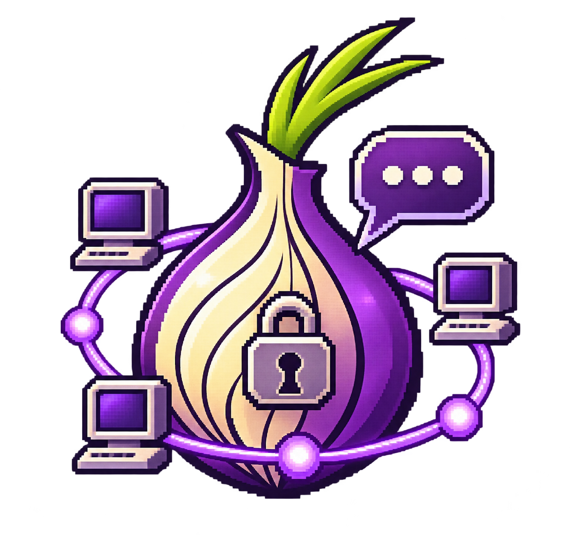
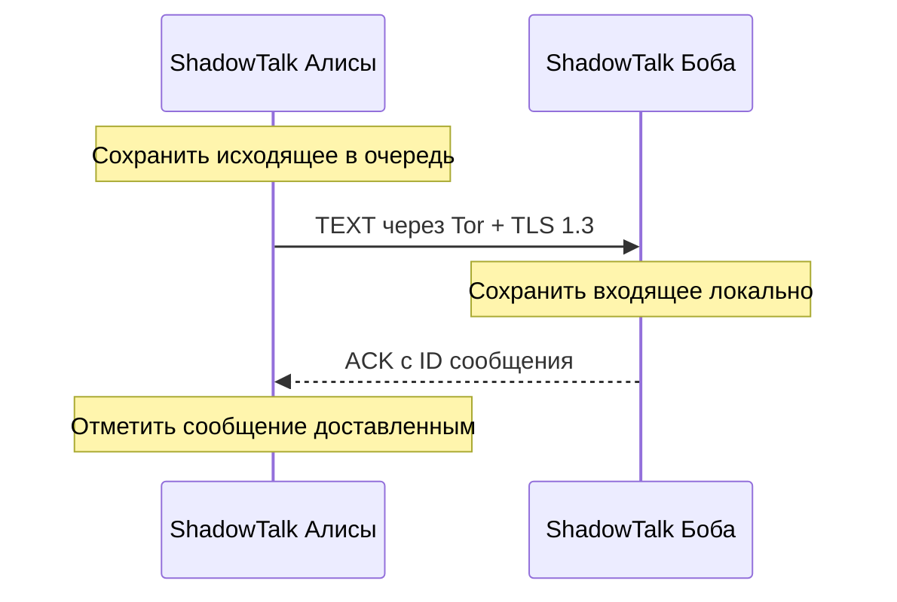

<div align="center">

  

  <h1>ShadowTalk</h1>

  <p>
    <b>P2P-мессенджер в вашем терминале.</b><br>
    Написан на Go. Подключается через Tor. Идентичность — криптографический ключ.
  </p>

  <p>
    <a href="https://go.dev/dl/"></a>
    <a href="https://github.com/bacrehclb/ShadowTalk/actions/workflows/test.yml?query=branch%3Amain"></a>
    <a href="LICENSE"></a>
    <br>
    
    
  </p>

  <p><a href="README.md">English</a> · <b>Русский</b></p>
  <p><b><a href="https://github.com/bacrehclb/ShadowTalk/releases/tag/v0.1.0-alpha.2">Скачать v0.1.0-alpha.2</a></b> — macOS · Windows · Linux</p>
  <p>
    <a href="#как-это-работает">Как это работает</a> ·
    <a href="#быстрый-запуск">Быстрый запуск</a> ·
    <a href="#использование">Использование</a> ·
    <a href="#troubleshooting">Решение проблем</a><br>
    <a href="#локальные-данные-и-безопасность">Локальные данные</a> ·
    <a href="#структура-проекта">Навигация по коду</a> ·
    <a href="#текущие-ограничения-и-следующие-проверки">Ограничения</a> ·
    <a href="#документация">Документация</a>
  </p>

</div>

---

## О проекте

ShadowTalk — терминальный мессенджер с открытым исходным кодом, написанный на Go. Создайте локальную идентичность, обменяйтесь приглашениями с собеседником и общайтесь через onion-службы Tor без общего сервера ShadowTalk. Ник — отображаемое имя; вашу идентичность определяет криптографический ключ.

> **Экспериментальная альфа:** реализованы личный терминальный чат, зашифрованная история сообщений и повторная доставка. Команды и форматы хранения могут меняться между альфа-версиями. Независимый аудит безопасности не проводился.
>
> Разработка идёт в **[ветке main](https://github.com/bacrehclb/ShadowTalk/tree/main)**. Для опубликованной версии используйте её тег, описание релиза и документацию внутри пакета.

## Что уже работает

| Возможность | Что доступно |
| --- | --- |
| Локальная идентичность | Ключи Ed25519, полный отпечаток SHA-256 и сохранение профиля |
| Хранение ключей | Seed зашифрован AES-256-GCM; ключ шифрования хранится в системном хранилище секретов |
| Терминальный интерфейс | Профиль, выбор контактов, редактор сообщений, страницы истории и статусы доставки |
| Приглашения | Подписанные токены с onion-адресом, публичным ключом и сроком действия |
| Контакты | Локальные имена, явная сверка отпечатка и сохранение между запусками |
| Защищённый канал | TLS 1.3 с взаимной проверкой подтверждённых ключей |
| Транспорт Tor | Управляемый процесс Tor и постоянный адрес onion v3 |
| История | Зашифрованный текст сообщений, распознавание дублей и страницы истории |
| Доставка | Постоянная очередь исходящих, подтверждение после сохранения, повторы после перезапуска и статусы ожидания/доставки |
| Сборки | DMG для macOS, установщик EXE для Windows и DEB/RPM для Linux |

Доставка и восстановление очереди после перезапуска проверены через публичную сеть Tor с obfs4: два узла работали на одном Mac arm64. Обмен между разными устройствами и работа через настоящую сеть на Windows/Linux пока не проверены. Точный объём проверки описан в [отчёте о сетевом тесте](docs/testing/tor-live-exchange.md).

## Как это работает

### Идентичность и поиск собеседника

У ShadowTalk нет сервера учётных записей или общего каталога ников. При создании
профиля генерируется случайный **seed** — секрет, из которого восстанавливаются
ключи идентичности. Для идентичности используется Ed25519; для onion-службы и
локальной истории выводятся отдельные ключи. Повторное открытие профиля сохраняет
прежнюю идентичность и onion-адрес. Создание нового профиля с тем же ником не
восстанавливает старый.

Чтобы найти друг друга, участники обмениваются **подписанными токенами приглашения**
вне ShadowTalk. Токен содержит публичный ключ, onion-адрес и срок действия.
Каждый сверяет полный отпечаток ключа с собеседником и сохраняет его в контактах.
Локальное имя контакта — только удобная подпись; доверие и переписка привязаны
к публичному ключу.

### Соединение и доставка сообщения

`shadowtalk chat` загружает профиль и подтверждённые контакты, открывает локальную
историю, запускает собственный процесс Tor и публикует onion-службу профиля.
В режиме obfs4 дополнительно запускается Lyrebird. Экран чата становится доступен
после запуска сети. Каждое соединение использует **TLS 1.3 с взаимной проверкой
идентичности**: обе стороны должны доказать владение ключом, который уже сохранён
у другого участника. Приглашение определяет, какому ключу доверять; TLS проверяет
этот ключ при соединении.



Сохранение происходит до отправки. Если собеседник недоступен или подтверждение
потерялось, исходящее остаётся в локальной очереди. ShadowTalk повторяет отправку
с тем же ID, в том числе после перезапуска; получатель распознаёт повтор и не
добавляет ещё одну копию в историю.

**Доставлено** означает, что клиент собеседника подтвердил сохранение сообщения.
Это не отметка о прочтении и не независимое доказательство действий изменённого
клиента. **Ожидает доставки** означает, что подтверждение ещё не получено.
Для доставки у обоих участников какое-то время должен одновременно работать
`chat` с готовым Tor. Общего сервера, который принял бы сообщение за отключённого
получателя, нет. Закрытие чата останавливает его сетевые процессы, сохраняя историю
и очередь исходящих на диске.

## Быстрый запуск

Оба участника устанавливают ShadowTalk, создают собственные профили и настраивают
Tor. Затем обмениваются приглашениями **в обе стороны** и открывают чат. Ниже —
пример для Алисы и Боба: выполняйте только команды своей стороны на своём компьютере.

### 1. Установка ShadowTalk

Скачайте **[ShadowTalk v0.1.0-alpha.2](https://github.com/bacrehclb/ShadowTalk/releases/tag/v0.1.0-alpha.2)**.
Откройте **Assets** на странице релиза и выберите установщик по таблице ниже.
Это опубликованная предварительная версия; перед установкой прочитайте её
описание. Другие версии доступны в [GitHub Releases](https://github.com/bacrehclb/ShadowTalk/releases).

| Платформа | Архитектуры | Файлы |
| --- | --- | --- |
| macOS 12+ | Apple Silicon и Intel в одном приложении | `_darwin_universal.dmg` (содержит `ShadowTalk.app`) |
| Windows | x64 (`amd64`) | `_setup.exe` |
| Linux | `arm64`, `amd64` | `.deb`, `.rpm` |

Скачайте один установщик для своей ОС и процессора. Переносимые архивы,
отдельные PKG и служебные файлы остаются в артефакте CI `shadowtalk-packages`
из [Packages](https://github.com/bacrehclb/ShadowTalk/actions/workflows/packages.yml?query=branch%3Amain).
Архивы **Source code**, которые добавляет GitHub, содержат исходники, а не готовое приложение.

Пакеты содержат уведомления о лицензиях зависимостей и распространяются
с контрольными суммами SHA-256. Подтверждённой подписи издателя пока нет;
приложение macOS имеет подпись ad-hoc и не прошло notarization.
Go нужен только для [сборки из исходников](#разработка).

**macOS:** откройте универсальный DMG, перетащите **ShadowTalk.app → Applications**
и запустите скопированное приложение. В Terminal откроется меню:
**1 — Профиль**, **2 — Чат**, **3 — Команды**, **0 — Выход**.
Для команд `shadowtalk ...` ниже выберите **3**: команда доступна внутри этого
окна без изменения системного PATH. Приложение открывает терминальный интерфейс.
Самостоятельная сборка описана в [руководстве macOS](docs/macos-app.md).
В артефакте CI также доступны альтернативный установщик PKG и переносимые архивы.

**Windows:** запустите установщик EXE, оставьте включённым добавление в PATH,
после установки откройте **новое** окно PowerShell или Windows Terminal.

**Linux:** откройте терминал в каталоге загрузок и выполните команду для своего
дистрибутива. Вместо `VERSION` и `ARCH` подставьте точное имя скачанного файла:

```sh
# Debian / Ubuntu
sudo apt install ./shadowtalk_VERSION_linux_ARCH.deb

# Fedora / дистрибутивы с DNF
sudo dnf install ./shadowtalk_VERSION_linux_ARCH.rpm
```

Проверьте установку командой `shadowtalk --version`. Проверка контрольных сумм
и удаление программы описаны в [инструкции установки](docs/install.md).

### Требования

- **Tor и Lyrebird** включены начиная с alpha.2. Для старой alpha.1 их нужно устанавливать отдельно. См. [поставку Tor](docs/bundled-tor.md) и [руководство подключения](docs/tor.md).
- **Доступное системное хранилище секретов:** Keychain на macOS, Credential Manager на Windows или Secret Service через пользовательский D-Bus на Linux. На Linux нужен работающий сервис секретов с доступной коллекцией login/default; одного D-Bus недостаточно.
- **Интерактивный терминал:** от 40 × 20 для экрана профиля и от 60 × 20 для меню и чата.

### 2. Создание профиля

На macOS откройте ShadowTalk.app и выберите **3 — Команды**.
На Windows/Linux после установки откройте терминал. Затем выполните:

```sh
shadowtalk --version
shadowtalk ui
```

Примеры ниже используют `shadowtalk` в командном окне приложения или в PATH.
Пункт **1 — Профиль** в меню приложения также открывает интерфейс профиля напрямую.
Для переносимого
архива запускайте `./shadowtalk` на macOS/Linux или `.\shadowtalk.exe`
в PowerShell из распакованного каталога. Для сборки из исходников используйте
путь к бинарнику из раздела [«Разработка»](#разработка).
Команды профиля и контактов работают без Tor.

Введите ник и нажмите **Enter**, чтобы создать профиль. При следующих запусках ShadowTalk загружает ту же идентичность. ОС может попросить разблокировать хранилище секретов или разрешить доступ к нему.

В нашем примере Алиса может выбрать `alice_01`, а Боб — `bob_01`. Когда профиль
появится на экране, нажмите **Esc**, чтобы вернуться в терминал. Команда `ui`
управляет профилем; для переписки дальше используется `chat`.

Ник содержит **3–24 символа**: латинские буквы, цифры, `_` и `-`; первый и последний символы — буква или цифра. Регистр учитывается, глобальная уникальность не требуется.

| Клавиша | Действие |
| --- | --- |
| Enter | Подтвердить действие, указанное на экране |
| `r` | Перечитать профиль; при вводе ника это обычная буква |
| Esc / Ctrl+C | Выйти после завершения активной операции с ключами |

Интерфейс и вывод команд сейчас на русском языке. Для TUI нужны терминальные stdin и stdout; в скриптах используйте обычные команды ниже. Непустая переменная `NO_COLOR` отключает цвета.

## Использование

### Работа через меню (исходники alpha.3 / следующий релиз)

В текущем коде есть общее меню: `shadowtalk menu`. Команда `shadowtalk` без
аргументов тоже открывает его в терминале. Новая сборка ShadowTalk.app запускает
меню автоматически. **Опубликованная alpha.2 пока использует старое меню из трёх
пунктов, описанное выше. Для нового меню нужна сборка из текущего кода.**

1. Выберите **Профиль**, придумайте ник, нажмите Enter. Затем Esc вернёт в меню.
2. Откройте **Настройки Tor и мосты**. Выберите прямое подключение или obfs4.
   Для obfs4 вставьте все строки мостов сразу, по одному мосту на строку.
   Нажмите **Ctrl+S**, задайте ожидание, например `5m`. Пути Tor и Lyrebird
   оставьте пустыми для автоматического выбора комплектных программ.
   **Tab** переключает поля; **Ctrl+S** сохраняет настройки.
3. Выберите **Создать приглашение**. Срок по умолчанию — `24h`.
   **c** копирует токен, **f** — отпечаток, **s** сохраняет новый файл приглашения.
   Существующий файл не перезаписывается. На macOS используется системный буфер;
   в других терминалах нужен OSC 52. Если копирование не работает, используйте файл.
4. Обменяйтесь приглашениями **в обе стороны**. Выберите **Добавить контакт**,
   вставьте полный токен или укажите путь файла, затем нажмите Ctrl+S.
   Проверьте данные, задайте локальное имя и вставьте полный отпечаток,
   полученный от собеседника по доверенному каналу. Подтвердите сохранение.
   Токен начинается с `shadowtalk://invite/v1/`; `SHA256:…` — только отпечаток.
5. Оба участника выбирают **Открыть чат** и ждут готовности Tor.
   Через **Контакты** можно выбрать диалог или подтвердить удаление контакта.
   Удаление сохраняет историю и не отзывает приглашения.

**Esc** возвращает назад без сохранения незавершённой формы. **Ctrl+C** завершает
текущий экран после активной записи; из профиля или чата возвращает в главное меню.
Нужно окно от **60 × 20**. Tor запускается только при открытии чата.
Настройки записываются в приватный `tor.json` в текущем каталоге профиля и
применяются при следующем запуске чата. Если другой экземпляр изменил файл,
меню попросит перечитать его. Ошибочные настройки не заменяют сохранённый файл.

Получение новых мостов пока не автоматизировано. В меню есть адреса
[сайта Tor Project](https://bridges.torproject.org/) и
[официального Telegram-бота](https://t.me/GetBridgesBot): `/start`, затем `/obfs4`.
Проверка формата и сохранение вставленных строк выполняются автоматически;
работоспособность мостов выясняется при подключении. Команды ниже также
поддерживаются и подходят для alpha.2.

### Управление профилем

Если вы ещё не создали профиль через TUI:

```sh
shadowtalk profile create --nick alice_01
```

Посмотреть профиль и отпечаток публичного ключа:

```sh
shadowtalk profile show
```

Создание не перезаписывает существующий профиль. `profile upgrade` добавляет ключи старому профилю, в котором есть только метаданные. `profile recover` обрабатывает прерванное создание; восстановить потерянный ключ шифрования из хранилища ОС эта команда не может.

<a id="tor-setup"></a>

### 3. Настройка Tor на каждом компьютере

Сборки для **alpha.2** уже содержат Tor и Lyrebird и находят их автоматически.
Для прямого подключения файл настроек не нужен. ShadowTalk сам запускает и
останавливает свой Tor; открытие Tor Browser не настраивает ShadowTalk.

Для опубликованной **alpha.1** или сборки из исходников без комплекта скачайте
стабильный [Tor Expert Bundle](https://download.torproject.org/tor/) под свою ОС
и процессор, сохранив библиотеки рядом с программами. В `tor_binary` укажите
путь к `tor`, а для obfs4 в `lyrebird_binary` — путь к `lyrebird` (на Windows
оба файла заканчиваются на `.exe`). В alpha.2 эти необязательные пути позволяют
использовать свои программы вместо комплектных.

Выберите **прямой Tor**, если ваша сеть разрешает подключение, или **obfs4**,
если нужны мосты. Алиса и Боб могут использовать разные режимы и разные мосты.

Для мостов или своих настроек создайте обычный текстовый файл **UTF-8 без BOM**
с именем `tor.json` в [каталоге профиля](#локальные-данные-и-безопасность).
Примеры используют автоматический поиск программ в alpha.2. Для alpha.1 добавьте
пути к исполняемым файлам, описанные выше.

**Прямое подключение:**

```json
{
  "version": 1,
  "mode": "direct",
  "startup_timeout": "5m"
}
```

Без `tor_binary` ShadowTalk выбирает комплектный Tor, а при отсутствии комплекта
ищет его в PATH. Без `tor.json` используется прямое подключение с тайм-аутом
запуска 3 минуты. Явно сохранённые пути продолжают действовать после обновления.

**Подключение через мосты obfs4:** получите свежие строки **obfs4** через
[сервис мостов Tor Project](https://bridges.torproject.org/) или способы из
[официального руководства](https://support.torproject.org/little-t-tor/circumvention/using-bridges/).
Полностью замените пример строки моста ниже настоящей строкой:

```json
{
  "version": 1,
  "mode": "obfs4",
  "startup_timeout": "5m",
  "bridges": [
    "obfs4 IP:PORT FINGERPRINT cert=CERTIFICATE iat-mode=0"
  ]
}
```

Каждый мост — одна полная строка в кавычках внутри массива; **между** строками
нужны запятые. Сохраните fingerprint, `cert` и `iat-mode` именно в полученном
виде. Строка выше — заполнитель, а не рабочий мост. ShadowTalk поддерживает
1–16 строк obfs4; Snowflake и WebTunnel в этой версии не поддерживаются.

На **Windows** используйте пути вида `C:/Tools/Tor/tor/tor.exe` и настоящий путь
к `lyrebird.exe`. В JSON допустимы прямые слеши; обратные нужно удваивать.
Убедитесь, что редактор сохранил `tor.json`, а не `tor.json.txt`.

На **macOS/Linux** после сохранения ограничьте доступ к файлу.
Выполните только команду для своей ОС:

```sh
# macOS
chmod 600 "$HOME/Library/Application Support/shadowtalk/tor.json"

# Linux
chmod 600 "${XDG_CONFIG_HOME:-$HOME/.config}/shadowtalk/tor.json"
```

Если используете свой каталог профиля, подставьте его путь. Не публикуйте файл
с мостами. JSON не допускает комментариев и запятых после последнего элемента;
неизвестные поля отклоняются. Относительные пути к бинарникам в JSON считаются
от каталога самого файла. Подробности — в [настройке Tor](docs/tor.md#конфигурация-подключения).

### 4. Обмен и подтверждение приглашений

Приглашение содержит публичный ключ, onion-адрес и срок действия. По нему другой
человек добавляет вас в контакты. **Оба участника должны добавить друг друга.**
Для создания и проверки приглашений подключение к Tor не требуется.

**Алиса создаёт своё приглашение** и смотрит собственный отпечаток:

```sh
shadowtalk profile show
shadowtalk invite create --ttl 24h > alice.invite
```

**Боб создаёт своё приглашение** на своём компьютере:

```sh
shadowtalk profile show
shadowtalk invite create --ttl 24h > bob.invite
```

В **Windows PowerShell** вместо `>` используйте подходящую команду ниже:
она сохранит файл без маркера кодировки. Выполните только свою строку:

```powershell
# Алиса
shadowtalk invite create --ttl 24h | Set-Content -Encoding ascii alice.invite
# Боб
shadowtalk invite create --ttl 24h | Set-Content -Encoding ascii bob.invite
```

Передайте `alice.invite` Бобу, а `bob.invite` — Алисе через уже доступный вам
канал связи. Файлы создаются в текущем каталоге терминала. Полученный файл тоже
сохраните туда или укажите его полный путь в `--file`. Если передаёте токен
текстом, сохраните одну целую строку без кавычек, форматирования и лишних пробелов.

**Алиса проверяет файл Боба:**

```sh
shadowtalk invite inspect --file bob.invite
```

Сверьте **полный отпечаток** со значением, которое Боб видит в
`shadowtalk profile show`, через доверенный канал — например, лично или по
знакомому голосовому контакту. Подпись подтверждает ключ, но не личность человека.
Если значения совпали, Алиса добавляет Боба: вместо `SHA256:...` нужно вставить
полный подтверждённый отпечаток **Боба**:

```sh
shadowtalk contacts add --alias bob --fingerprint "SHA256:..." --file bob.invite
shadowtalk contacts show --alias bob
```

**Боб повторяет проверку для Алисы:** смотрит её приглашение, отдельно сверяет
отпечаток с Алисой и подставляет полный отпечаток **Алисы** в команду добавления:

```sh
shadowtalk invite inspect --file alice.invite
shadowtalk contacts add --alias alice --fingerprint "SHA256:..." --file alice.invite
shadowtalk contacts show --alias alice
```

`--alias` — ваше локальное имя контакта: у Алисы это `bob`, у Боба — `alice`.
Оно подчиняется правилам ника и может отличаться от ника профиля собеседника.
Эти команды сохраняют контакты локально; сеть запускается командой `chat`.

- По умолчанию приглашение действует **24 часа**; `--ttl` принимает целое число секунд в диапазоне от `1s` до `168h`.
- Токен содержит публичные данные идентичности, включая onion-адрес, но не приватные ключи. Передавайте его выбранным людям.
- До истечения срока токен можно использовать повторно. Одноразовое принятие и отзыв ещё не реализованы. Сохранённые контакты остаются после истечения приглашения.
- `--file -` читает один токен из stdin до EOF. Результаты идут в stdout, ошибки — в stderr; при ошибке возвращается код `1`.

Удалить локальный контакт, подтвердив его сохранённый отпечаток:

```sh
shadowtalk contacts remove --alias alice --fingerprint SHA256:...
```

Это удаляет локальную запись, но не отзывает приглашения. Справка по командам: `--help`, `invite --help` и `contacts --help`.

### 5. Отправка первого сообщения

Когда контакты подтверждены, а `tor.json` настроен, **Алиса запускает**:

```sh
shadowtalk chat --contact bob
```

**Боб запускает** на своём компьютере:

```sh
shadowtalk chat --contact alice
```

Оставьте оба окна чата открытыми. Дождитесь подключения каждого участника к Tor
и публикации onion-службы: одних 100% bootstrap ещё недостаточно. Когда появится
диалог, при необходимости нажмите **Tab**, чтобы перейти к редактору, введите
короткое сообщение и нажмите **Enter**. Попросите собеседника ответить.

Статус исходящего сообщения сменится с `ожидает доставки` на `доставлено`,
когда другое устройство подтвердит его сохранение. Надпись `Tor готов` означает
готовность вашего узла Tor; она не подтверждает, что собеседник сейчас онлайн.

Если файл настроек находится вне стандартного каталога профиля:

```sh
shadowtalk chat --contact bob --tor-config "/absolute/path/to/tor.json"
```

Чтобы использовать свой Tor вместо комплектного, укажите исполняемый файл (`tor.exe` на Windows):

```sh
shadowtalk chat --tor-binary "/path/to/tor" --startup-timeout 5m
```

Экран покажет процент bootstrap и этап подключения Tor, затем контакты, историю и редактор сообщений. По умолчанию запуск Tor ограничен 3 минутами; `--startup-timeout` принимает от 1 секунды до 15 минут. История открывается после готовности Tor. Без `--contact` выбирается первый сохранённый контакт. Приглашения и контакты управляются командами выше; для применения изменений перезапустите чат.

Настройки подключения можно сохранить в `tor.json` внутри профиля или выбрать файл через `chat --tor-config "/path/to/tor.json"`. Явные флаги `--tor-binary` и `--startup-timeout` имеют приоритет над файлом. Отсутствие файла по умолчанию включает прямое подключение к Tor; ошибка файла останавливает запуск. Повтор через Enter / `r` перечитывает настройки.

Режим мостов не переключается автоматически на прямой Tor. При ошибке запуска
исправьте настройки или замените недоступные мосты, затем нажмите **Enter**
или **r** на экране ошибки. Для применения изменений во время работающего чата
его нужно перезапустить.

### 6. Повторный запуск и управление

В следующий раз Алиса запускает `shadowtalk chat --contact bob`, а Боб —
`shadowtalk chat --contact alice`. Заново создавать профиль и обмениваться
приглашениями для уже сохранённых контактов не нужно. Для выбора среди всех
контактов запустите `shadowtalk chat`; их имена покажет `shadowtalk contacts list`.

| Клавиша | Действие в чате |
| --- | --- |
| Tab | Переключить контакты / ввод |
| ↑ / ↓ в списке | Выбрать диалог |
| Enter | Перейти к вводу или сохранить сообщение в очередь |
| Alt+Enter / Ctrl+J | Новая строка |
| PgUp / PgDn | Прокрутка; PgUp вверху загружает старые сообщения |
| Ctrl+L | Последние сообщения и актуальные статусы |
| Ctrl+R после ошибки записи | Повторить сохранение с тем же ID |
| Esc / Ctrl+C | Остановить сеть и выйти |

Метка `•` у контакта показывает изменения за этот запуск, а не факт прочтения. Сообщение **ожидает доставки**, пока не придёт подтверждение сохранения собеседником; тогда появится **доставлено**. Для доставки оба участника должны быть онлайн. Сохранённая очередь продолжит работу при следующем запуске `chat`; несохранённые черновики остаются только в памяти. Экран хранит до 200 записей за раз, старые сообщения остаются в базе.

Лимит текста — 16384 байта UTF-8. Слишком большая вставка отклоняется, управляющие последовательности отображаются безопасно. Команда `chat` требует терминальные ввод и вывод, сообщения через pipe не принимает. Подробности: `chat --help`.

Выходите через **Esc** или **Ctrl+C** и дождитесь остановки Tor. Доставка работает,
пока открыт `chat`; фонового сервера для хранения сообщений нет. После перезапуска
история и очередь доступны в том же профиле. Время в чате отображается в UTC.

<a id="troubleshooting"></a>

## Решение проблем

| Что произошло | Что проверить |
| --- | --- |
| Команда `shadowtalk` не найдена | Для приложения macOS выберите **3 — Команды** в его меню. На Windows включите PATH в установщике и откройте новый терминал; для переносимой сборки укажите полный путь к исполняемому файлу. |
| `ui` показывает профиль, а переписки нет | Выйдите через Esc и выполните `shadowtalk chat`; приглашения и контакты добавляются командами из шага 4. |
| Tor или Lyrebird не найден | В `tor_binary` / `lyrebird_binary` укажите исполняемый файл, а не каталог. На Windows нужно окончание `.exe`; библиотеки Expert Bundle должны оставаться на месте. |
| Tor не успел подключиться | Проверьте сеть, при необходимости обновите мосты obfs4 и повторите запуск. Можно задать `--startup-timeout 10m`; максимум — `15m`. |
| «Небезопасный tor.json» или ошибка конфигурации | Нужен обычный файл UTF-8 без BOM, корректный JSON и настоящие пути/мосты. На macOS/Linux выполните `chmod 600` для этого файла. |
| Приглашение просрочено или повреждено | Попросите новый токен. Сохраните строку целиком; в PowerShell используйте команду с ASCII выше. Проверьте системные дату и время на обоих устройствах. |
| Отпечатки не совпали | Прекратите импорт и сверьте полное значение с собеседником. Не подставляйте непроверенный отпечаток ради успешного выполнения команды. |
| Контакта нет или имя не принимается | Выполните `shadowtalk contacts list`, проверьте выбранный каталог профиля и перезапустите чат после добавления контакта. |
| Сообщение остаётся в ожидании | У обоих должен работать `chat` с готовым Tor; каждый должен добавить актуальную идентичность другого. Оставьте окна открытыми для автоматических повторов. |
| Недоступно хранилище ключей | Разблокируйте хранилище ОС и разрешите доступ. На Linux нужны пользовательская сессия, работающий Secret Service и разблокированная коллекция login/default; не запускайте чат через `sudo`. |
| Окно слишком маленькое | Увеличьте его хотя бы до 60 столбцов × 20 строк. Запускайте в интерактивном терминале с подключёнными stdin/stdout. |

Для сообщения об ошибке укажите ОС, `shadowtalk --version`, выполненную команду
и текст ошибки. Перед публикацией уберите токены приглашений, строки мостов
и личные пути. Приватные ключи, файлы профиля и историю сообщений в issue не прикладывайте.

## Локальные данные и безопасность

### Где находится профиль

ShadowTalk сохраняет данные текущего пользователя ОС отдельно от установленного
приложения. macOS-приложение и отдельная CLI используют один каталог по умолчанию:

| ОС | Каталог профиля по умолчанию |
| --- | --- |
| macOS | `~/Library/Application Support/shadowtalk` |
| Linux | `$XDG_CONFIG_HOME/shadowtalk` или `~/.config/shadowtalk` |
| Windows | `%AppData%\shadowtalk` |

Для другого каталога укажите `--profile-dir` **перед** командой:

```sh
shadowtalk --profile-dir ./data/demo ui
```

Относительный путь отсчитывается от рабочего каталога терминала. Для дальнейшей
работы с этой идентичностью указывайте тот же `--profile-dir` в командах `profile`,
`invite create`, `contacts` и `chat`. Например:

```sh
shadowtalk --profile-dir ./data/demo profile show
shadowtalk --profile-dir ./data/demo chat
```

### Что хранится на диске

Файлы появляются по мере создания профиля, добавления контактов и запуска чата;
сразу после установки существуют не все из них.

| Расположение | Содержание и назначение |
| --- | --- |
| `profile.json` | Ник, дата создания и публичный ключ идентичности. Незашифрованные метаданные; приватного ключа здесь нет. |
| `identity-seed.json` | Приватный seed, зашифрованный AES-256-GCM, и ID ключа из системного хранилища секретов. |
| `contacts.json` | Локальные имена, подтверждённые публичные ключи, onion-адреса и даты контактов. Не зашифрован; раскрывает связи между контактами. |
| `messages.db` | SQLite с историей и очередью исходящих. Текст сообщений зашифрован XChaCha20-Poly1305 ключом, выведенным из seed профиля. |
| `messages.db-wal`, `messages.db-shm` | Служебные файлы SQLite, которые могут существовать при открытой истории. Участвуют в работе базы. |
| `tor.json` | Необязательные настройки подключения: режим, пути к программам, таймаут и строки мостов. Открытый текст; создаётся по [инструкции Tor](#tor-setup). |
| `tor/` | Рабочие данные Tor. Временные каталоги `.shadowtalk-run-*` содержат файлы управления конкретным запуском и, при использовании мостов, состояние Lyrebird; штатное завершение удаляет эти временные каталоги. |
| `profile-pending.json` | Журнал с метаданными профиля, зашифрованным seed и ID ключа ОС для восстановления прерванного создания или обновления. Обычно удаляется после завершения операции. |
| `.profile.lock`, `.contacts.lock`, `.tor-config.lock`, `.messages.lock`, `tor/.shadowtalk.lock` | Координируют доступ к файлам профиля, контактам, истории и каталогу Tor. Наличие файла само по себе не означает, что приложение запущено; не удаляйте их для обхода блокировки. |
| Хранилище секретов ОС, вне каталога профиля | Случайный ключ для расшифровки seed: macOS Keychain, Windows Credential Manager или Linux Secret Service. Имя сервиса — `ShadowTalk/seed-encryption/v1`; поле `account` совпадает с `key_id` из `identity-seed.json`. |

Файлы приглашений вроде `alice.invite` создаются там, куда вы перенаправили вывод
команды, а не автоматически в каталоге профиля. Они содержат публичную
идентичность и адрес, поэтому передавайте их только нужным собеседникам.

### Что защищает шифрование

Шифрование защищает seed и **текст сообщений**, а не весь каталог профиля или
SQLite целиком. Ключи собеседников, ID сообщений, направления, время, длины и
метаданные доставки остаются видимыми в истории. Отдельного пароля ShadowTalk нет;
при недоступном хранилище ОС ключ не сохраняется открытым текстом на замену ему.
Доступ к разблокированной учётной записи ОС и её хранилищу секретов может открыть
идентичность и историю: локальное шифрование не защищает от скомпрометированной
работающей ОС.

### Копии, обновление и восстановление

Замена исполняемого файла или приложения не заменяет профиль. Используйте тот же
каталог и ту же учётную запись ОС. Форматы данных в альфе могут меняться, поэтому
перед обновлением или возвратом на старую версию читайте описание релиза.

**Копия каталога профиля сама по себе не является переносимой резервной копией
идентичности.** Для восстановления нужны зашифрованный seed и соответствующий
ему ключ ОС. Для чтения истории также нужен исходный seed. Поддерживаемой команды
переносимого резервного копирования/экспорта и синхронизации между устройствами
пока нет. Такой же ник, публичный ключ или приглашение не восстановят секрет.

`profile recover` завершает прерванное локальное создание или обновление по
сохранённому журналу и соответствующему ключу ОС. Он не воссоздаёт секреты,
которые больше нигде не сохранены. Перед копированием каталога профиля завершите
ShadowTalk; если у базы остались служебные файлы SQLite, сохраняйте их вместе
с ней. Такая копия всё равно не включает ключ ОС. Не удаляйте и не
редактируйте файлы профиля вручную для исправления ошибки запуска. Форматы,
модель доверия и ограничения защиты подробнее описаны в
[документе о безопасности](docs/security.md).

<a id="план-развития"></a>

## Текущие ограничения и следующие проверки

Первая публичная альфа — **[v0.1.0-alpha.1](https://github.com/bacrehclb/ShadowTalk/releases/tag/v0.1.0-alpha.1)**.
В неё входят личный текстовый чат, локальная история и повторная доставка.

**[alpha.2](docs/releases/v0.1.0-alpha.2.md)** включает Tor и Lyrebird.
В текущем исходном коде готовится **[alpha.3](docs/releases/v0.1.0-alpha.3.md)**
с общим терминальным меню. Alpha.3 ещё не опубликована. Профиль, ключи, контакты
и история остаются на прежних местах. Собственные пути исполняемых файлов
сохраняют приоритет; оставьте их поля пустыми в новом меню для комплектных программ.

- Обмен между разными устройствами и работа через настоящую сеть на Windows/Linux ещё требуют проверки; успешные автоматические тесты этого не подтверждают.
- Мосты могут понадобиться и с комплектным Tor. Экран чата требует успешного запуска Tor, в том числе для просмотра сохранённой истории.
- Контакты и приглашения доступны в меню (исходники alpha.3) и командах CLI; после изменения контактов чат нужно открыть заново. Интерфейс пока только на русском.
- Группы, вложения, отметки о прочтении, отдельный графический интерфейс и синхронизация между устройствами не реализованы. macOS-приложение `.app` открывает Terminal.
- У истории нет автоматического ограничения срока хранения; лимит в 200 записей ограничивает только объём, загруженный на экран.

Групповые комнаты и возможный GUI остаются направлениями развития без
зафиксированной даты выпуска. Сначала — терминальный клиент.

## Структура проекта

Приложение состоит из одного Go-модуля с точкой запуска в
[`cmd/shadowtalk`](cmd/shadowtalk). Терминальный интерфейс, правила чата, сетевой
транспорт и хранение разделены по пакетам. macOS-launcher — упаковочная оболочка
вокруг того же исполняемого файла.

| Модуль | За что отвечает |
| --- | --- |
| [`cmd/shadowtalk`](cmd/shadowtalk) | Разбирает команды и флаги, выбирает каталог профиля, связывает конкретные сервисы и переводит ошибки для пользователя. Начните с [`cli.go`](cmd/shadowtalk/cli.go); сборка зависимостей чата — в [`chat_cli.go`](cmd/shadowtalk/chat_cli.go). |
| [`internal/app`](internal/app) | Координирует сценарии: создание/восстановление профиля, импорт контакта, запуск сети и истории. [`StartDelivery`](internal/app/delivery.go) собирает полный сервис чата и освобождает ресурсы при ошибке запуска. |
| [`internal/identity`](internal/identity) | Правила ников, профили, ключи Ed25519, шифрование seed и отдельный вывод ключей onion/истории. Без файловой системы и терминального интерфейса. |
| [`internal/contacts`](internal/contacts) | Подпись и проверка приглашений, срок действия, подтверждение отпечатка и правила доверенных контактов. Хранение подключается отдельно. |
| [`internal/tui`](internal/tui) | Экраны профиля и чата на Bubble Tea: клавиши, выбор контакта, страницы истории и безопасный вывод. Обращается к сервисам, не выполняет SQL и не открывает сокеты. |
| [`internal/delivery`](internal/delivery) | Сохраняет исходящие, планирует повторы, обрабатывает подтверждения и сохраняет входящие до отправки ACK. Отвечает за доставку, а не за терминал. |
| [`internal/chat`](internal/chat) | Живые диалоги поверх проверенных сессий: отправка/приём текста, подтверждения и события приложения. Сам по себе не сохраняет сообщения на диск. |
| [`internal/peers`](internal/peers) | Подключается к подтверждённым контактам, принимает доверенные входящие соединения, задаёт лимиты и управляет временем жизни сессий. |
| [`internal/securechannel`](internal/securechannel) | Оборачивает готовое соединение в TLS 1.3 и проверяет сохранённые ключи обеих сторон. Не ищет контакты и не запускает Tor. |
| [`internal/torbundle`](internal/torbundle) | Находит комплектные Tor/Lyrebird относительно приложения; явные пути имеют приоритет. Без загрузок и изменения профиля. |
| [`internal/transport/tor`](internal/transport/tor) | Запускает/останавливает Tor и Lyrebird, отслеживает bootstrap, публикует onion-службу и подключается через SOCKS. |
| [`internal/onion`](internal/onion) | Разбирает и проверяет адреса onion v3 независимо от работающего Tor. |
| [`internal/protocol`](internal/protocol) | Версии кадров TEXT/ACK, ID сообщений, кодирование и ограничения размеров. Правила обмена, а не управление соединениями. |
| [`internal/history`](internal/history) | Записи сообщений, правила дублей/конфликтов и интерфейсы хранения с постраничным чтением. |
| [`internal/storage`](internal/storage) | Конкретные адаптеры: `profilefile` и `seedfile` — файлы записей, `profiledir` — согласованное создание/восстановление, `keyring` — секреты ОС, `contactsfile` — контакты, `torconfig` — JSON-настройки, `sqlite` — зашифрованная история и очередь. |
| [`tests/integration`](tests/integration) | Проверки взаимодействия модулей и процессов, в том числе доставки после перезапуска. Проверки через публичный Tor включаются явно. |
| [`packaging`](packaging) | Установщики, macOS-launcher, уведомления о лицензиях и подготовка файлов релиза. Конфигурация сборки — в [`.goreleaser.yaml`](.goreleaser.yaml) и [`.github/workflows`](.github/workflows). |
| [`docs`](docs) | Архитектура, протокол, безопасность, проектные решения и зафиксированные результаты проверок. |

### Где менять конкретное поведение

| Изменение | С чего начать |
| --- | --- |
| Новая команда или флаг | [`cmd/shadowtalk/cli.go`](cmd/shadowtalk/cli.go) и файл соответствующей команды; сам сценарий разместите в `internal/app`. |
| Клавиши или внешний вид чата | [`internal/tui/chat.go`](internal/tui/chat.go) и [`chat_view.go`](internal/tui/chat_view.go). |
| Повторы или статусы доставки | [`internal/delivery`](internal/delivery); сохраните правило «сначала запись, потом ACK» и повтор с тем же ID. |
| Новое поле в хранилище | Соответствующий адаптер хранения; для истории — [`миграции SQLite`](internal/storage/sqlite/migrations) с учётом существующих профилей. |
| Формат сетевого сообщения | [`internal/protocol`](internal/protocol) и [`docs/protocol.md`](docs/protocol.md); учитывайте собеседников со старой версией. |
| Настройка Tor | [`storage/torconfig`](internal/storage/torconfig), [`transport/tor`](internal/transport/tor) и [`chat_network.go`](cmd/shadowtalk/chat_network.go). |
| macOS-приложение или установщики | [`packaging`](packaging), [руководство приложения](docs/macos-app.md) и [инструкция выпуска](docs/releases.md). |

Тесты лежат рядом с пакетами в файлах `*_test.go`. Сохраняйте правила предметной
области и протокола независимыми от терминального вывода и файлового хранения;
границы зависимостей описаны в [архитектуре](docs/architecture.md).

## Документация

Ссылки ведут на документы выбранной ветки или тега релиза. Большинство технических документов написано на русском; инструкции установки и выпуска — на английском.

| Документ | Содержание |
| --- | --- |
| [Обзор проекта](docs/overview.md) | Цели и пользовательские сценарии |
| [Архитектура](docs/architecture.md) | Границы модулей и зависимости |
| [Протокол](docs/protocol.md) | Приглашения, кадры текста и формат подтверждений |
| [Безопасность](docs/security.md) | Хранение ключей, доверие и ограничения |
| [Поставка Tor](docs/bundled-tor.md) | Автоматический поиск, расположение программ, проверка загрузок и обновление версии |
| [Транспорт Tor](docs/tor.md) | Запуск, жизненный цикл и результаты проверок |
| [Проверка macOS ↔ Docker](docs/testing/macos-docker.md) | Ручной обмен с отдельным Linux-профилем и сохраняемым keyring |
| [Проектные решения](docs/decisions) | Обоснование принятых решений |
| [Установка](docs/install.md) | Пакеты, зависимости и первый запуск |
| [Релизы](docs/releases.md) | Сборка, уведомления о лицензиях и публикация |

## Разработка

Для сборки из исходников нужны **Go 1.26 или новее** и Git. Клонируйте репозиторий:

```sh
git clone https://github.com/bacrehclb/ShadowTalk.git
cd ShadowTalk
```

Для существующего релиза выберите его тег. Для работы над следующей версией
выполните `git switch main`. Участники проекта могут создать свою ветку от неё.

```sh
# macOS / Linux
go build -o ./bin/shadowtalk ./cmd/shadowtalk
./bin/shadowtalk --version
./bin/shadowtalk ui
```

```powershell
# Windows PowerShell
go build -o ./bin/shadowtalk.exe ./cmd/shadowtalk
.\bin\shadowtalk.exe --version
.\bin\shadowtalk.exe ui
```

Запускайте проверки из корня репозитория:

```sh
go test ./...
go vet ./...
go build ./...
```

На macOS и Linux также запускайте `go test -race ./...`. CI выполняет тесты, vet и сборку на Windows, macOS и Linux; race detector включён на macOS и Linux. Автоматические проверки интерактивного терминала покрывают macOS и Linux; взаимодействие с терминалом Windows пока требует ручной проверки.

Обычные тесты используют временные данные и подставные хранилища ключей. Они не обращаются к настоящим секретам ОС или публичной сети Tor.

<details>
<summary>Дополнительные проверки с настоящим хранилищем секретов или Tor</summary>

Эти проверки включаются явно. Тест хранилища создаёт временный профиль и удаляет свой тестовый ключ. Проверкам Tor нужен его исполняемый файл, а сетевой проверке — ещё и доступ к сети. Ниже приведён синтаксис оболочки macOS/Linux.

```sh
# Настоящее хранилище ОС; может появиться системный диалог доступа.
SHADOWTALK_NATIVE_KEYRING_TEST=1 go test ./cmd/shadowtalk -run '^TestNativeKeyStoreProfileLifecycle$' -count=1 -v

# Настоящий контроллер Tor и onion-ключ без подключения к сети Tor.
SHADOWTALK_TOR_BINARY=/absolute/path/to/tor go test ./internal/transport/tor -run '^TestNativeTorControl$' -count=1 -v

# Настоящий Lyrebird и настройки мостов Tor при отключённой внешней сети.
SHADOWTALK_TOR_BINARY=/absolute/path/to/tor SHADOWTALK_LYREBIRD_BINARY=/absolute/path/to/lyrebird go test ./internal/transport/tor -run '^TestNativeObfs4Control$' -count=1 -v

# Публичная сеть Tor: двусторонняя доставка, сохранение ACK и восстановление очереди после перезапуска.
SHADOWTALK_TOR_BINARY=/absolute/path/to/tor SHADOWTALK_TOR_LIVE_TEST=1 go test ./tests/integration -run '^TestTorSecureChannelLive$' -count=1 -v -timeout=15m
```

В PowerShell задайте соответствующие переменные через `$env:NAME = 'value'` перед запуском `go test`. Для сетевой проверки мостов дополнительно задайте `SHADOWTALK_TOR_CONFIG` с путём к файлу подключения; `SHADOWTALK_TOR_BINARY` переопределяет путь бинарника из файла. Сетевой тест использует временные профили, тестовые ключи и зашифрованную историю SQLite. Он выключает получателя, ставит сообщение в очередь, перезапускает оба узла и проверяет автоматическую доставку без дублей в истории. По умолчанию на каждый запуск Tor отводится 3 минуты (можно изменить в файле), на весь сценарий — 12 минут; при недоступной сети возможен тайм-аут. Обычный CI выполняет этот же сценарий с локальными тестовыми процессами; доступность публичной сети Tor он не подтверждает. Результаты запусков — в [описании проверок Tor](docs/tor.md#ошибки-и-проверки).

</details>

## Участие в разработке

Приветствуются сообщения об ошибках, проверки на разных платформах и небольшие улучшения. Перед крупными изменениями откройте [issue](https://github.com/bacrehclb/ShadowTalk/issues), чтобы согласовать объём работы.

1. Сделайте fork репозитория и создайте ветку от `main`.
2. Решайте одну задачу за раз; обновите относящиеся к ней тесты и документацию.
3. Запустите проверки выше и откройте pull request в `main`.

В сообщении об ошибке укажите ОС, вывод `shadowtalk --version` и шаги воспроизведения. Для сборки из исходников также укажите коммит и версию Go. Не прикладывайте приватные ключи, настоящие приглашения, адреса мостов, файлы профиля и содержимое сообщений к issues или коммитам.

## Лицензия

[MIT](LICENSE) · Copyright © 2026 1tuz.

Сборки содержат `THIRD_PARTY_NOTICES.txt` с текстами лицензий зависимостей
и Go. Пути к ним указаны в [инструкции установки](docs/install.md#licenses).

---

<div align="center">
  <a href="README.md">English</a> · <a href="README.ru.md">Русский</a>
</div>
